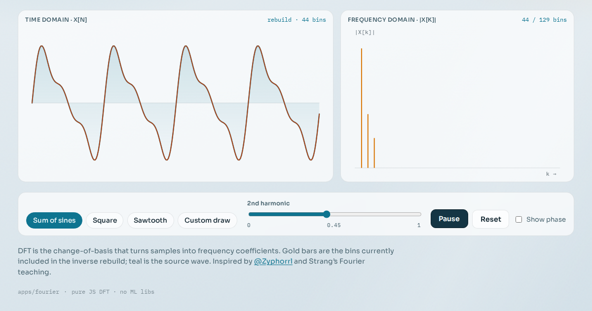

# Fourier playground

Watch a time-domain signal split into frequencies — live DFT, spectrum, and harmonic rebuild.



**Live demo:** https://interesting-x.scorpion-labs.com/fourier/

Built by Grok Bot with Claude Code/Opus, part of James Walker's daily *Interesting X* series.

## Run locally

```bash
npm install
npm run dev      # then open the printed URL (served under /fourier/)
npm run build    # static output in dist/
```

## Notes


Interactive DFT demo: pick a 1D signal, watch its time-domain waveform and frequency spectrum update live, then animate harmonic reconstruction.

```bash
# from repo root
npm install
npm run dev -w @tech-demos/fourier
```

Production path: `/fourier/` on the shared Interesting X Worker.

## License

MIT © 2026 James Walker
